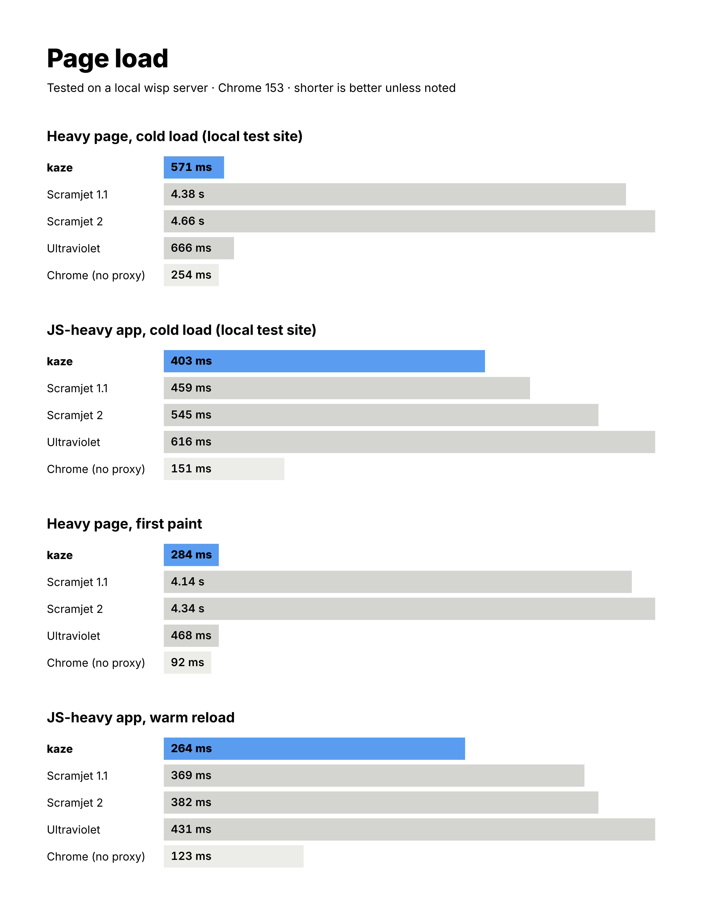
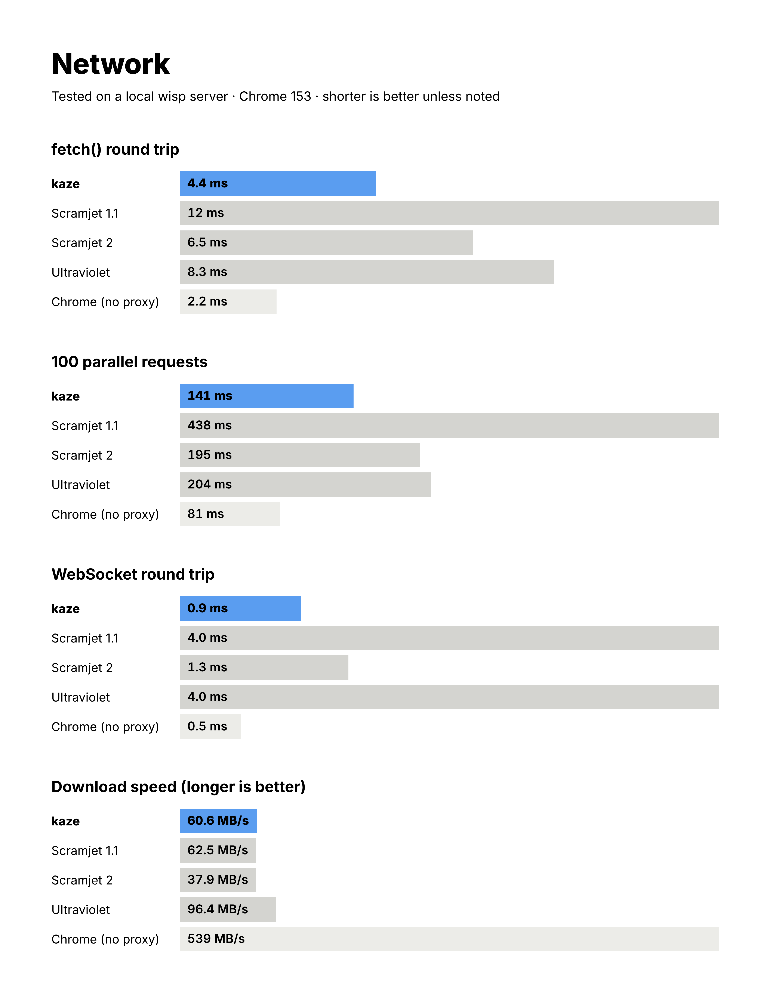
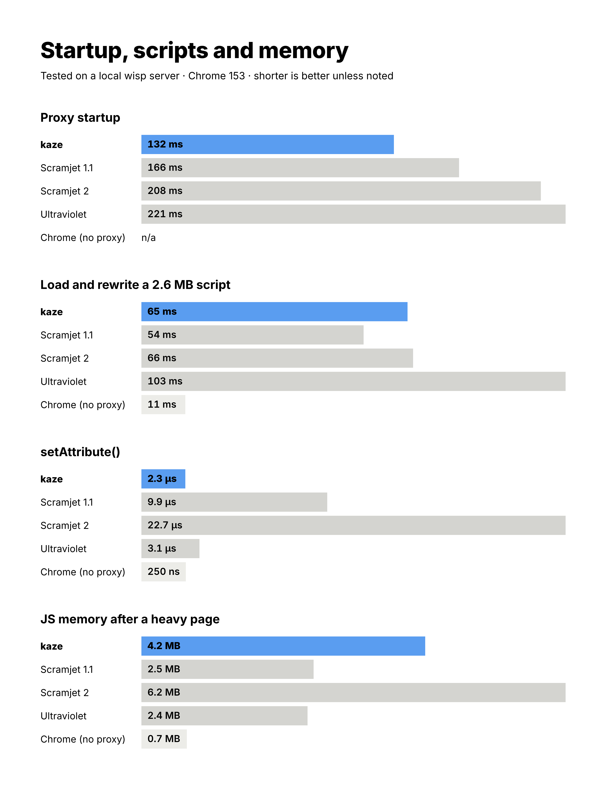

<p align="center"></p>

a web proxy that runs in ur browser. its a fork of [scramjet](https://github.com/MercuryWorkshop/scramjet) by mercury workshop, renamed and tuned to be stupid fast.

## speed

fastest in 23 of 30 tests vs scramjet and ultraviolet, including every page load test. 93 overall (uv 54, scramjet 1.1 39, scramjet 2 38).

all tested on a local wisp server btw, so ur numbers will be diffrent on a real one. this run was on a 4 core cloud box with the local test pages only (no live sites), so its not directly comparable to older runs.







still loses on raw download speed and memory (uv), rewriting one huge 2.6 MB script (scramjet 1.1), `document.cookie` and `replaceState`. working on it.

live results are at `/benchmarks/` on the site, it updates every time u run a benchmark.

## add it to ur site

```html
<script src="/kaze-assets/kaze-embed.js" defer></script>
<div data-kaze="https://example.com" style="height: 600px"></div>
```

thats it for the page. setup for ur server is in [packages/embed](packages/embed/README.md).

not on npm yet btw, so build it from here for now:

```sh
cd packages/embed && pnpm build
```

## coming from scramjet

most sites just swap one script. run `node packages/embed/cli.mjs migrate ur-site/` and it shows u what it would change, add `--write` to do it. full guide [here](packages/embed/MIGRATING.md).

## whats in here

| package               | what                                     |
| --------------------- | ---------------------------------------- |
| `packages/core`       | rewriter (rust to wasm), hooks, fetching |
| `packages/controller` | service worker and the fetch engine      |
| `packages/embed`      | one line site setup, scramjet migration  |
| `packages/site`       | search page, wisp server, benchmark site |
| `packages/runway`     | tests and benchmarks                     |

## building

u need node 23+, pnpm, rustup, `wasm-bindgen` 0.2.105, [wasm-opt](https://github.com/WebAssembly/binaryen) and [this wasm-snip fork](https://github.com/r58Playz/wasm-snip).

```sh
pnpm i
cd packages/core && RELEASE=1 pnpm rewriter:build && cd ../..
pnpm build
```

## running

```sh
cd packages/site && pnpm start   # localhost:8080
```

## tests and benchmarks

```sh
cd packages/runway
OMIT_WPT=1 node --experimental-strip-types src/index.ts [filter]
node --experimental-strip-types src/bench/compare.ts
```

add `RUNWAY_CHANNEL=chrome` if u dont have playwright's chromium. the benchmark needs uv and scramjet installed, check the top of `compare.ts`.

## license

AGPL-3.0, same as scramjet. definately go look at their stuff too.
